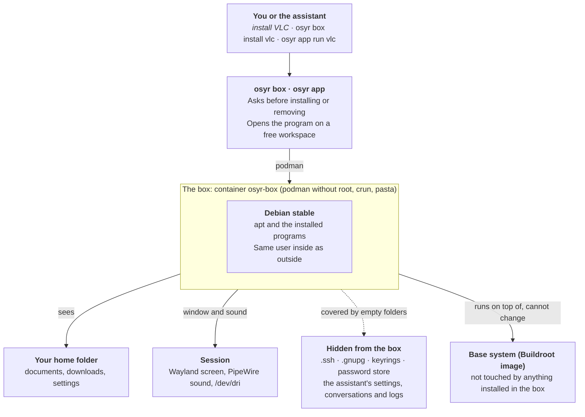

# osyr

**OSYR** is an operating system with its own AI assistant that runs on the laptop itself, even without Internet, on ordinary 8 GB machines. This repository is its base: a Buildroot `BR2_EXTERNAL` tree for x86_64 that builds a bootable image (USB, BIOS and UEFI) and a VirtualBox appliance.

Website and downloads: [ccmai.org/osyr](https://ccmai.org/osyr/) · Help and keyboard shortcuts: [ccmai.org/osyr/help.html](https://ccmai.org/osyr/help.html)

## What it does

- **Local AI**: Qwen3.5-4B (with vision) on the CPU through llama.cpp, which picks the fastest code for each processor. The context size adapts to the RAM.
- **The assistant** runs the system through the `osyr` command line (JSON output): wifi, sound, screens, Bluetooth, brightness, temperature, power, reminders, disks, backups, files, the browser and updates. It asks before changing anything.
- **Shell with protections**: for what the `osyr` commands do not cover, the assistant runs shell commands. The system, not the model, decides: what only reads runs without asking; what changes something shows the command and asks (yes, always or no); what is destructive is blocked. Design: [docs/SHELL-DESIGN.md](docs/SHELL-DESIGN.md).
- **Installing programs**: `osyr box install <program>` puts them in a Debian container, the box, without touching the system; `osyr app` opens and closes them. See [Installing software](#installing-software-the-box).
- **Voice**: hold Super+Space and speak (whisper.cpp); natural spoken answers with Piper voices (sherpa-onnx) in seven languages, with a choice of speaker; dictation into any window.
- **Screen and clipboard**: `/look` shows the screen to the model; it can summarise or translate what you copied.
- **Optional remote providers** (your own server, OpenAI, Anthropic, Gemini, Ollama Cloud, OpenRouter, any OpenAI-compatible API). Keys are entered on your phone through an encrypted pairing page, never typed on screen.
- **Desktop**: sway + foot with a WarGames look, PipeWire sound, Bluetooth, several screens, screen lock, notifications.
- **Install to disk**: `sudo osyr-install` (erases the disk): system A and B, `/home` optionally encrypted with LUKS2. `osyr update image` puts a new signed image in the other slot, boots it on trial and goes back by itself if it does not start.
- **Signed updates**: `osyr update code` follows signed `v*` tags (most of them apply without rebooting), checks daily, notifies once per version and never installs on its own; exact rollback.
- **Support**: `osyr sys selftest` checks the hardware; `osyr-diag` sends logs and the self-test (your conversations only if you ask for it with `/report chats`).

## Status

Early test build, **v0.32.0** (13 Nov 2026). It boots in QEMU (BIOS and UEFI) and earlier versions have been tested on two HP laptops (2019 and 2014), installed to disk on the older one. Roadmap and decisions: [docs/ARCHITECTURE.md](docs/ARCHITECTURE.md); work log: [docs/MILESTONE-0.md](docs/MILESTONE-0.md); what comes next for the assistant and its training: [docs/TRAINING-PLAN.md](docs/TRAINING-PLAN.md). Full list of changes: [changelog](https://ccmai.org/osyr/changelog.html).

### New in v0.32.0

- **Shell tool** for the assistant, with the protections described above. A heavy command comes with a plain line saying what it does ("This deletes 214 files (1.2 GB) in ~/Downloads"), and `sudo` asks for your password as usual.
- **`osyr box`**: install, search, list, remove, update and reset programs in a Debian container.
- **`osyr app`**: `list`, `run <name> [file]` and `stop <name>`, for the system's applications and the box's.
- Files are found by saying what they are called and read by their bare name.
- The assistant takes up to 12 steps per request, stops when a call repeats with the same result, and takes a "no" as final for that request.

The box is a first version: its checks pass against a stand-in for the container engine, and the run with the real engine inside the image is still pending. Programs that only speak X11 have no window yet (there is no Xwayland in the image).

## Installing software: the box

The base system is a read-only image that only changes as a whole (A/B update), so programs are not installed into it. They go into one container per user, created the first time something is installed.



- Everything the box holds lives in your home folder (`~/.local/share/containers`), so it survives system updates; `osyr box reset` empties it.
- It needs the Internet and free disk space (it refuses below 500 MB): if OSYR runs from the USB stick, install it to disk first.
- Programs without a window run with `osyr box run <command>`.

## Requirements

- To run it: a 64-bit PC with 8 GB of RAM (16 GB recommended) and a 16 GB USB stick, or VirtualBox. Without AVX2 the local model is very slow: use a server model.
- To build it: Linux, ~60 GB of disk, and patience (about 1 h 20 min from scratch with 16 cores; much less with ccache).

## Build and test

```bash
git clone https://github.com/ccarrillomanzanares/osyr && cd osyr
make model        # Qwen3.5-4B Q4_K_M + vision projector + whisper model into models/ (~3.4 GB)
make              # clones Buildroot 2026.08.1 into build/buildroot the first time
make qemu         # or 'make qemu-uefi'; QEMU_DISPLAY=vnc=:1 on a headless server
make test         # native (image binaries on the host), vm (QEMU) and install (disk installer)
```

The image is written to `build/output/images/osyr.img`. Write it to a USB stick with `dd`, balenaEtcher or Rufus.

Publishing (maintainers): `scripts/publish.sh img` then `scripts/publish.sh vbox` (USB image, then VirtualBox appliance; both regenerate the website from `web/`), and `scripts/release.sh vX.Y.Z` to sign a release for `osyr update code`.

## Layout

| Path | Contents |
|---|---|
| `configs/osyr_x86_64_defconfig` | Buildroot configuration |
| `board/osyr/` | kernel fragment, GRUB, image layout, post-build and post-image scripts |
| `board/osyr/rootfs-overlay/` | everything OSYR adds: the `osyr` CLI (`usr/lib/osyr`), the chat and agent, session, services, themes, help |
| `package/` | extra packages (whisper.cpp, grim, swaylock, wl-clipboard...) |
| `tests/` | `make test` |
| `web/` | website templates for ccmai.org/osyr |
| `scripts/` | publishing, signed releases, model download, diagnostics receiver |

## License

MIT
