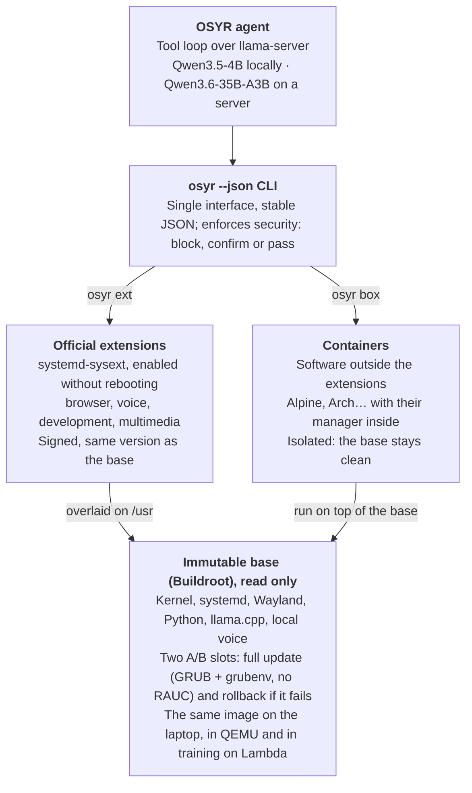
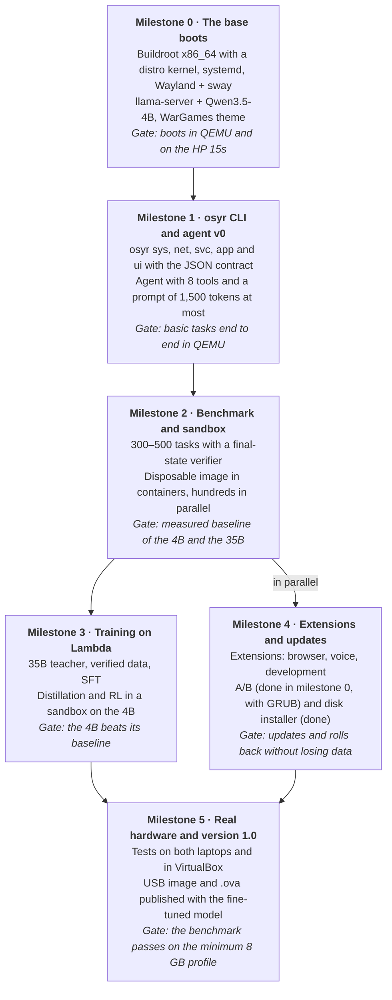

# OSYR — Architecture of the new system

28 Oct 2026 · Carlos Carrillo


## Summary

The new OSYR is an operating system built from scratch with Buildroot and designed around a small AI agent that runs on the CPU of old 8 GB laptops. The agent is a computing expert (from low level to architecture and SRE), speaks the European languages, sees the screen and uses tools; if the user has a server, it can lean on a large model.

The difference from the previous system is not the base but the design order: there the agent was adapted to a system that grew patch by patch; here the OS, the agent interface and the model training are designed together from day one.

| Piece | Previous system | New OSYR |
| --- | --- | --- |
| Base | LFS 13 + sven (Arch packages) | Buildroot, immutable image with A/B update |
| Extra software | sven over the root, which gets modified | Own `systemd-sysext` extensions + containers |
| Agent interface | 29 tools, free-text output | 3 fixed tools (`osyr`, `clipboard`, `look`): almost everything goes through the `osyr` CLI with JSON |
| Fixed prompt | ~7,000 tokens with 8K of context | ≤ 1,500 tokens |
| Local model | Qwen3.5-9B Q4 (6.2 GB) | Qwen3.5-4B fine-tuned for OSYR |
| Server model | Qwen3.6-35B-A3B untrained | Qwen3.6-35B-A3B fine-tuned (and teacher of the 4B) |
| Kept | — | Local + server, voice and vision, WarGames look |

## Design principles

Every technical decision is checked against six principles; if a feature breaks them, it is redesigned before it is built.

1. **The small model rules.** Everything is designed so that a 4B on CPU does it well. Whatever only works with the large model is an extra, not the base.
2. **The OS speaks structured data.** The agent works with the `osyr` CLI, which returns short JSON and errors with a code. The free shell exists, but it is the last resort.
3. **Knowledge goes in the weights and in the documentation, not in the prompt.** Fixed prompt of 1,500 tokens at most; the rest is looked up with a tool.
4. **Security lives in the OS.** Read-only root, A/B, confirmations and blocks enforced by the system, not politely requested from the model.
5. **Everything is verifiable.** Every feature is born with its test cases and a verifier of the final state. That is at once the benchmark and the training data factory.
6. **One image, everywhere.** The same image boots on the laptop, in QEMU and in the training containers on Lambda. The model is trained on the exact system the user receives.

## The three layers

OSYR has no classic package manager: Buildroot does not produce binary packages by design, so software is organised in three layers and the agent manages all of them through the `osyr` CLI.



The base only changes as a whole, through the A/B update; extensions are enabled and removed without touching it; whatever is not in any extension goes in a container. It is the same model Home Assistant OS uses (Buildroot + A/B + containers). In OSYR the A/B is our own and is done (v0.27): two roots, GRUB chooses with `grubenv`, the new one boots once on trial and, if it does not get to work, the previous one comes in next time; RAUC was evaluated and was not needed. In addition, the overlay code is updated through git with signed tags (`osyr update code`), almost always without rebooting.

## Two systems, one base

OSYR and newos share a single `BR2_EXTERNAL` tree with two configurations: same base, same agent, same model and same CLI; only the face the user sees changes.

| | OSYR | newos |
| --- | --- | --- |
| Main interaction | Keyboard, agent terminal | Voice |
| Interface | sway + foot terminal, WarGames look | Kiosk compositor (cage) + web interface in WPE WebKit |
| Model | Local, own server or API key | Same (today only API key; being rethought) |

**Common to both:** kernel and firmware, systemd, Wayland (mesa, seatd), llama.cpp, agent and `osyr` CLI, local voice, extensions and A/B update. Local, own server and API-key provider speak the same OpenAI-compatible API, so for the agent they are interchangeable.

**Graphical environment: Wayland on both.** Recommended, for four reasons:

- i3 is not in Buildroot and sway is; sway reads i3 configuration, so your shortcuts and your theme carry over almost unchanged.
- newos already solved Wayland on Buildroot (mesa, seatd, GPU driver loading, fallback framebuffer).
- `swaymsg -t get_tree` returns the windows as JSON: the agent knows what is on screen without using vision.
- X11 is in maintenance mode.

The cost: xdotool does not work on Wayland. Screenshots and keyboard input are done with grim and wtype, which have to be packaged (they are small).

**What changes in newos to join the common base:**

- BusyBox init → systemd (required by `systemd-sysext`).
- llama-cpp-python with Llama 3.1 8B → `llama-server` with the shared Qwen models.
- `<tool>` tags with GBNF → standard tool calling, the same format used in training.
- A single pinned Buildroot version (today a 2024.02 copy in the repo and the Makefile's 2024.11.1 coexist).

**Voice first has consequences for the model:** short spoken answers (no tables or code), tolerance to recognition errors and spoken confirmations. They go into the benchmark and the training data as a mode of their own.

## The osyr CLI and its JSON contract

`osyr` is the single interface of the system, for the user and for the agent: every command accepts `--json` and always returns the same shape. That way the model never has to interpret the free-form output of Linux tools, which is where a 4B fails the most.

```json
{"ok": false,
 "code": "NET_NO_LINK",
 "data": {"iface": "wlan0", "state": "down"},
 "hint": "Run: osyr net wifi connect <ssid>",
 "confirm": null}
```

- `ok` and `code`: result and stable error code, documented and in English.
- `data`: only what is needed, compact; long lists paginated.
- `hint`: the suggested next step, in one line.
- `confirm`: if the action is destructive, the command does not run it and returns a token; it is repeated with `--confirm <token>` after the user's yes.

| Namespace | Examples | Purpose |
| --- | --- | --- |
| `osyr sys` | `status`, `health`, `logs --unit X` | CPU, RAM, disk, temperature status, recent errors |
| `osyr net` | `status`, `wifi scan`, `wifi connect` | Wired network and wifi |
| `osyr ext` | `search`, `install`, `remove`, `list` | Official extensions (the "package manager") |
| `osyr app` | `list`, `run --bg`, `stop` | Launch and close graphical applications |
| `osyr svc` | `list`, `start`, `stop`, `enable` | systemd services |
| `osyr box` | `create`, `exec`, `rm` | Containers for software outside the extensions |
| `osyr update` | `code check/apply/rollback`, `image check/apply/rollback` | Signed code from git; whole image in the other A/B slot (GRUB) |
| `osyr ai` | `status`, `model`, `server` | Local model, remote server, voice |
| `osyr ui` | `theme`, `keyboard`, `screen` | WarGames theme, keyboard, screenshot |
| `osyr doc` | `osyr doc wifi` | OSYR documentation as short text, the RAG source |

The CLI is written in Python and is also the basis of the verifiers: each test case checks the final state with `osyr ... --json`.

## The agent

The agent is a function-calling loop over `llama-server` (OpenAI-compatible API) with a few fixed tools and packs loaded on demand. The same agent works with the local model and with the server one.

**What milestone 0 has:** three fixed tools, `osyr(cmd)`, `clipboard()` and `look(question)`. Reading files, the browser, the user's memory, reminders and the web are `osyr` subcommands (`osyr files`, `osyr web`, `osyr memory`...), not separate tools: that way the fixed prompt does not grow and the 4B does not have to choose among many. There is no free `shell` and no `write_file`. The following table is the initial design and stays as a reference for what would be missing.

**Fixed tools (initial design):**

| Tool | What it does |
| --- | --- |
| `osyr(cmd)` | Runs an `osyr` CLI command and returns its JSON |
| `shell(cmd, timeout)` | Free shell, trimmed output; last resort |
| `read_file(path, range)` | Reads a file in chunks |
| `write_file(path, content)` | Writes a file; system paths blocked |
| `docs(topic)` | Looks up the OSYR documentation (RAG) |
| `look(question)` | Takes a screenshot and describes it with the vision model |
| `load_tools(pack)` | Loads a pack: `desktop`, `browser`, `media`, `dev` |
| `ask_server(task)` | Escalates the task to the server model, if configured |

**Context budget on an 8 GB machine:** fixed prompt + tools ≤ 1,500 tokens, total context 16K. Tool outputs are trimmed to ~1,000 tokens and the history is summarised at 75 %. The prefix (system + tools) never changes, so that the `llama-server` cache avoids reprocessing it every turn.

**Memory:** stable notes about the user and the machine in `~/.osyr/memory.md`, served by `docs("memory")` instead of being injected into the prompt.

**Security:** the previous agent's command classification (block / confirm / pass) moves to the OS: the CLI and the `shell` wrapper enforce it. The previous agent's test suite is kept as a contract.

**Tiers:**

- **Local:** fine-tuned Qwen3.5-4B, on the machine itself, without a network.
- **Server:** fine-tuned Qwen3.6-35B-A3B on a VPS or a desktop with ≥ 32 GB. A machine can use it as its main model or only through `ask_server`, which asks the user for permission the first time because it takes data off the machine.

Both models share tokenizer, chat template and tool format: the user sees a single agent.

## Voice, vision and the WarGames interface

The three pieces are kept from the previous project, but local by default, with the cloud as an option.

**Voice.** Local recognition with whisper.cpp (multilingual quantised `small` model, detects the language) and local synthesis with Piper voices through sherpa-onnx (one voice per first-boot language; espeak-ng if there is no voice for the language). Both go in the base, not in an extension: decided in milestone 0 because voice is part of the interface. If the user configures them, cloud engines (such as gemini-live's natural conversation mode).

**Vision.** Qwen3.5-4B is already multimodal, so `look()` works without a network: it takes a screenshot, scales the image down to a low token budget and asks the model itself. For documents or dense screens, `look()` uses the server model if available. Agent priority: first `osyr ... --json` or the browser DOM, vision only when there is no other source.

**WarGames interface.** The identity is kept: silent boot with a banner, phosphor terminal (green, amber, white, cyan), typewriter effect with a tick and movie quotes. Minimal desktop with sway (reads the i3 configuration) and the foot terminal; the theme is applied with `osyr ui theme`. The agent console is the main screen, and graphical applications open in other workspaces.

## Model and training

Nothing is trained from scratch: two open models of the Qwen family (Apache 2.0) are fine-tuned with the $7,000 of Lambda credits, about 1,750 H100 hours. Pretraining our own model with that budget would give a ~1B without vision, worse than current bases.

- **Local:** Qwen3.5-4B (dense, vision, tool calling, 201 languages, linear attention that uses little memory on long context).
- **Server and teacher:** Qwen3.6-35B-A3B (MoE, ~3B active, vision, tool calling). It already runs on your VPS.

Fine-tuning teaches **behaviour**: using the `osyr` CLI, the tool protocol, asking for confirmation, verifying, not getting into loops, answering in the user's language. The concrete OSYR **data** goes in `docs()`, not in the weights.

| Phase | What | Approx. cost |
| --- | --- | --- |
| 0. Benchmark | 300–500 tasks on the OSYR image, with a verifier; measure both models untrained | ~$100 |
| 1. Fine-tune the teacher | SFT of the 35B-A3B with OSYR trajectories: better teacher, verifier and server tier | ~$1,500 |
| 2. Verified data | The teacher solves tasks in hundreds of instances of the image; only those the verifier approves are kept | ~$2,000 |
| 3. SFT + distillation | From the teacher to the 4B, with on-policy distillation (same tokenizer) | ~$1,000 |
| 4. RL in a sandbox | GRPO on the 4B with a verifier reward and a safety penalty | ~$1,500 |
| Reserve | Iterations | ~$900 |

Rule: no phase is passed without improving on the benchmark. Test cases come from every new OS feature and from the previous agent's catalogue of real failures (loops, sudo, apps in the foreground, polling, claiming things that did not happen).

## Target hardware

The floor is an 8 GB x86_64 laptop with a single memory module, like the HP 15s-fq1xxx (i5-1035G1, DDR4-3200 on one channel). The speeds are estimates based on memory bandwidth; they will be measured in phase 0.

| Profile | Example | Model | Estimated generation |
| --- | --- | --- | --- |
| Minimum | 8 GB, one channel | Qwen3.5-4B Q4 | ~5–7 tok/s |
| Recommended | 16 GB, dual channel (add a SODIMM) | Qwen3.5-4B Q4–Q6 | ~10–14 tok/s |
| Server | ≥ 32 GB, or a 16 vCPU / 64 GB VPS | Qwen3.6-35B-A3B Q4–Q8 | to be measured on your VPS |

Measured on real hardware (milestone 0, Qwen3.5-4B Q4_K_M, 4 threads):

| Machine | CPU | Prompt reading | Generation | Local model? |
| --- | --- | --- | --- | --- |
| HP 15s-fq1xxx (2019) | i5-1035G1, AVX-512, 7.5 GiB | 14–24 tok/s | 3.5–4.1 tok/s | Yes (floor) |
| HP 15-ba (old) | AMD A8-7410, AVX without AVX2, 6.7 GiB | ~3 tok/s | ~1.1 tok/s | No: the fixed prompt takes 5 min and a short answer, one minute |

**Hardware limit**: without AVX2 the local model is not usable. OSYR boots and works the same (graphical session, sound, network, voice), but the agent must use a remote provider: the VPS server or a third-party one (`/pair`). Decided with the user (30 Oct): no smaller model is added for these machines.

- The real bottleneck on CPU is processing the prompt, not generating: that is why the fixed prefix is short and stable.
- `llama.cpp` is built with runtime CPU variant selection, so that a single image works from AVX1 to AVX-512 without the SIGILL that happened with the AMD A8.
- The base without the model must take < 1 GB of RAM at idle, to leave ~6 GB for the model and the context in the minimum profile.

## Roadmap

Six milestones, each with a gate that must be met before moving on; the credits are spent in milestone 3, when there is already a system, a CLI and a benchmark to train on.



**First deliverable (milestone 0):** a new repository with a `BR2_EXTERNAL` tree (Buildroot configuration, x86_64 kernel with a distro config, systemd, Wayland + sway, llama.cpp with CPU variants and the WarGames theme) that produces an image and boots in QEMU with `llama-server` serving Qwen3.5-4B. It is built on your Contabo VPS; Lambda is not needed.

## Risks and open decisions

The biggest risk is that Buildroot is meant for embedded systems, not for laptops: drivers, firmware and desktop have to be put together by hand.

**Risks**

| Risk | Mitigation |
| --- | --- |
| PC hardware support (wifi, GPU, audio, suspend) | Start from a distro's kernel config, as you did with kernel #7; full `linux-firmware`; test early on both laptops |
| Browser: Firefox and Chromium are not in official Buildroot | Package the official Firefox binary as a sysext extension, with GTK3 in the base; requires glibc |
| `systemd-sysext` requires extensions to match the base version | Extensions built from the same tree and published with each base version |
| A/B on PCs with BIOS and UEFI | Done without RAUC: GRUB + `grubenv`, trial boot and rollback; tested in QEMU (BIOS and UEFI) and on the HP 15-ba (BIOS) |
| The 4B does not reach the expected level | The benchmark will tell early; plan B: recommended 16 GB profile with a larger model |
| Lambda credits with an expiry date | ~12 months left: milestones 0–2 in the first 4–5 months and training from then on |

**Open decisions**

- [x] Lambda credits: about 12 months left.
- [x] Language of the agent and of the `osyr` CLI: Python, like both current agents.
- [x] Graphical environment: Wayland (sway in OSYR, kiosk in newos).
- [x] Distribution: USB image (`osyr.img.xz`, BIOS and UEFI) with a disk installer, and `osyr.ova` for VirtualBox. There is no ISO.
- [x] Second OS: newos, on the same Buildroot base.
- [ ] Repository where the common base lives.

## Sources

- [Buildroot user manual](https://buildroot.org/manual.html)
- [Buildroot FAQ: why there are no binary packages](https://lists.buildroot.org/pipermail/buildroot/2014-January/388701.html)
- [Buildroot: llama-cpp updated to b8117 (March 2026)](https://lists.buildroot.org/pipermail/buildroot/2026-March/799169.html)
- [systemd-sysext (manual)](https://www.freedesktop.org/software/systemd/man/260/systemd-sysext.html)
- [RAUC: examples and integration](https://rauc.readthedocs.io/en/stable/examples.html) (evaluated; OSYR's A/B does not use it)
- [A/B boot on x86 with QEMU (Mind)](https://mind.be/blog/2025/06/25/qemu-a-b-boot-x86-part-3.html)
- [Qwen3.5-4B](https://modal.com/library/qwen/qwen3-5-4b)
- [Qwen3.6-35B-A3B](https://docs.sglang.io/cookbook/autoregressive/Qwen/Qwen3.6)
- [Lambda pricing](https://www.lambda.ai/pricing)
- Reference repository: [newos](https://github.com/ccarrillomanzanares/newos)
